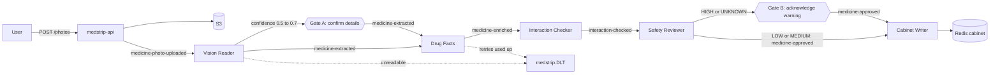
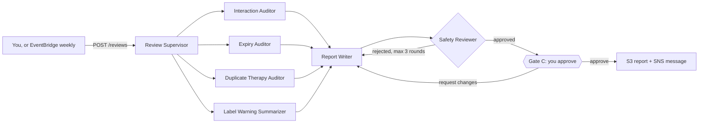
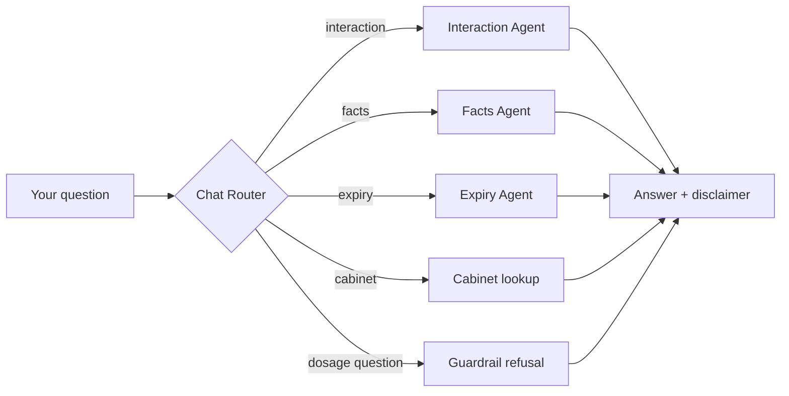

Requirements · Kafka, Redis, AWS, Spring AI, LangChain4j

# MedStrip

Photograph a medicine strip. A team of agents reads it, looks up official warnings, checks it against your cabinet, reviews the whole cabinet in parallel, and asks you before anything risky is saved or sent.

- **11** agents
- **6** workflow patterns
- **3** human gates
- **10** AWS services
- **9** failure drills
- **3 to 4** days

[Scope](#scope) [Flows](#flow) [Workflow patterns](#patterns) [AWS](#aws) [Agents](#agents) [Cabinet review](#review) [Human gates](#gates) [Topics](#topics) [Messages](#contracts) [Storage](#storage) [API](#api) [Risk levels](#risk) [Failure drills](#failures) [Console](#console) [Build order](#build) [Done when](#done)

## Scope

Core

- Upload a strip photo, get a job id at once.
- Vision Reader, Drug Facts, Interaction Checker, Safety Reviewer, Cabinet Writer.
- Cabinet per user in Redis. Retry, dead letter topic, retake outcome.

Agentic workflows

- Cabinet review with a supervisor and four parallel subagents.
- Writer and critic loop with a round limit.
- Chat router that picks the right specialist.
- Three human gates that pause and resume a workflow.

AWS extras

- S3, SNS, DynamoDB on LocalStack first.
- Bedrock and Textract on real AWS when you are ready.
- EventBridge Scheduler, Secrets Manager, CloudWatch, Step Functions as stretch.

Console

- One HTML page that shows every feature.
- Works with mock data on its own, or against your API.

**Safety rules.** This is a learning project, not medical advice. Use your own photos or sample strips, never someone else's. No agent gives dosage advice or a diagnosis. Show "Not medical advice. Ask a pharmacist." on every chat answer and on every HIGH or UNKNOWN result. Set an AWS budget alert before you turn on Bedrock or Textract.

## Flows

### A. Add a medicine (sequential, event driven)



### B. Review the whole cabinet (parallel, loop, human approval)



### C. Ask a question (routing)



### Job status for flow A

UPLOADED→ READING→ NEEDS_CONFIRMATION→ LOOKING_UP→ CHECKING→ REVIEWING→ AWAITING_ACK→ DONE

Other endings: NEEDS_RETAKE REJECTED FAILED

## Workflow patterns you will practise

| Pattern | Where it appears | What you learn |
| --- | --- | --- |
| **Sequential** (chain) | Flow A. Each agent reads the previous agent's output and passes its own on through a Kafka topic. | Handoff contracts, idempotent steps, where to retry. |
| **Parallel** (fan out, fan in) | Flow B. Four auditors run at once. Optional: Textract and the vision model both read the same photo. | Timeouts per lane, partial results, merging structured outputs. Parallel time is the slowest lane, not the sum. |
| **Routing** (conditional) | Flow C. The router picks one specialist, or the guardrail refusal. | Classifying intent, fallback route, keeping a guardrail outside the model. |
| **Supervisor** (orchestrator and workers) | Flow B start. The Review Supervisor plans which auditors are needed and hands each a slice of the cabinet. With fewer than 2 medicines it skips the interaction and duplicate auditors. | Delegation, passing context to subagents, collecting structured results. |
| **Loop** (evaluator and optimizer) | Flow B. Report Writer drafts, Safety Reviewer critiques, up to 3 rounds. | Stop conditions, what to do when the loop never converges. |
| **Human in the loop** | Gates A, B and C. | Pausing without blocking a Kafka consumer, saving state, resuming on a decision, timeouts. |

Both libraries cover these. See the [Spring AI effective agents guide](https://docs.spring.io/spring-ai/reference/1.1/api/effective-agents.html) (chain, parallelization, routing, orchestrator-workers, evaluator-optimizer) and the [LangChain4j agentic module](https://docs.langchain4j.dev/apidocs/dev/langchain4j/agentic/declarative/package-summary.html) (sequence, parallel, loop, conditional, supervisor). A good split: Spring AI for flow A, LangChain4j agentic for flows B and C. Check the current docs for exact class names.

Flow A is **choreography**: agents react to Kafka events and nobody is in charge. Flow B is **orchestration**: one supervisor owns the plan and the result. Building both shows you the trade-off. Flow A survives a crashed agent by replaying events. Flow B is easier to follow and test.

## AWS services

| Service | Use in MedStrip | Run it | When |
| --- | --- | --- | --- |
| **S3** | Strip photos (`photos/`) and approved reports (`reports/`). | LocalStack | start |
| **SNS** | Topic `medstrip-alerts`. Message when a report is approved and sent, and for expiring items. | LocalStack | start |
| **DynamoDB** | Table `agent_runs`: one item per agent execution (agent, workflow, duration, tokens, status, summary). Powers the Runs screen. | LocalStack | start |
| **Bedrock** | The language and vision model for both Spring AI and LangChain4j. | Real AWS, pay per use. Use Ollama locally while building. | next |
| **Textract** | OCR of the strip text, run in parallel with the vision model. If they disagree on the name, confidence drops and Gate A asks you. | Real AWS, small cost | next |
| **EventBridge Scheduler** | Weekly trigger that calls `POST /reviews` for each user. Replaces a Spring scheduler. | Real AWS or LocalStack | next |
| **Secrets Manager** or **SSM Parameter Store** | Model keys and the optional openFDA key. No keys in `application.yml`. | LocalStack | later |
| **CloudWatch** | Logs plus a custom metric per agent: duration and failures. | Real AWS | later |
| **Step Functions** | Rebuild flow B as a state machine: a Parallel state for the auditors and a wait-for-callback task for Gate C. Compare it with the code version. | Real AWS | stretch |
| **ECS Fargate**, **ElastiCache**, **MSK** | Deploy the two apps, and swap Redis and Kafka for the managed versions. | Real AWS | stretch |

Run S3, SNS, DynamoDB and Secrets Manager against LocalStack by pointing the AWS SDK at its endpoint. Bedrock and Textract need a real account.

## Agents

| Agent | Flow | Input → output | Edge cases |
| --- | --- | --- | --- |
| **Vision Reader** | A | `medicine-photo-uploaded` → `medicine-extracted`. Name, strength, expiry, confidence. | Under 0.5: `NEEDS_RETAKE`. 0.5 to 0.7: Gate A. Not an image: DLT. |
| **Drug Facts** | A | `medicine-extracted` → `medicine-enriched`. Calls openFDA, up to 5 warning bullets, cached 24 h. | 3 s timeout, backoff. Still down: `source: "unavailable"`. |
| **Interaction Checker** | A | `medicine-enriched` + cabinet → `interaction-checked` with risk and reasons. | No label text means `UNKNOWN`, never `LOW`. |
| **Safety Reviewer** | A, B | In flow A: `interaction-checked` → `medicine-approved`. In flow B: critic of the report draft. | Removes dosage or diagnosis wording. Adds "ask a pharmacist" on HIGH and UNKNOWN. HIGH and UNKNOWN stop at Gate B. |
| **Review Supervisor** | B | Review request → plan, then starts the auditors. | Skips auditors that have nothing to check. Keeps going when one lane fails. |
| **Interaction Auditor** | B | Checks every pair in the cabinet → findings with risk. | 20 s lane timeout. |
| **Expiry Auditor** | B | Items expiring within 30 days (MEDIUM) and 90 days (LOW). | 20 s lane timeout. |
| **Duplicate Therapy Auditor** | B | Two items in the same class, such as two NSAIDs. | 20 s lane timeout. |
| **Label Warning Summarizer** | B | Top warning per medicine from cached label text. | 20 s lane timeout. Slowest lane. |
| **Report Writer** | B | Merges auditor findings into the draft report. Revises on critic notes or your comment. | Max 3 critic rounds. |
| **Chat Router** | C | Question → route (`interaction`, `facts`, `expiry`, `cabinet`, `guardrail`) → specialist answer. | Dosage questions are refused before any model call. Follow-ups reuse the last medicine. Memory: last 10 messages. |

**Cabinet Writer** is plain code, not an agent. It saves the medicine, skips a duplicate with the same name, strength and expiry, and sets the job to `DONE`.

## Cabinet review workflow

The main task. The supervisor delegates, the subagents return structured results, and the main agent writes the final report.

1. **Trigger.** `POST /reviews` from the console, or EventBridge Scheduler weekly. Publishes `review-requested`.
2. **Plan.** The Review Supervisor reads the cabinet and decides which auditors to run. Fewer than 2 medicines: expiry and label warnings only.
3. **Fan out.** Start the chosen auditors at the same time. Each has a 20 second timeout and returns `{agent, findings[], ms}`.
4. **Fan in.** Wait for all lanes. A lane that fails or times out is marked unavailable and the review continues with partial results.
5. **Draft.** Report Writer merges findings into sections: Needs attention, Expiry, Duplicate therapy, Label warnings.
6. **Critic loop.** Safety Reviewer checks the draft: no dosage advice, every HIGH or UNKNOWN item says to ask a pharmacist, every finding names its source. Rejected drafts go back to the writer. After 3 rejected rounds the report is flagged "not approved" and cannot be sent.
7. **Gate C.** Status `AWAITING_APPROVAL`. You approve, or request changes with a comment, which sends the draft back to the writer for another round.
8. **Publish.** Save the report to `s3://medstrip-reports/{userId}/{reviewId}.md`, publish to SNS, publish `review-completed`.
9. **Log.** Every agent run is written to the DynamoDB `agent_runs` table, with the review id as the reference.

## Human gates

A gate is a stop, not a wait. Never block a Kafka consumer while a person thinks. Save the context in Redis, end the step, and resume when the decision API publishes an event.

| Gate | Opens when | You can | If nobody answers |
| --- | --- | --- | --- |
| A Confirm details | Vision confidence is 0.5 to 0.7. Status `NEEDS_CONFIRMATION`. | Confirm, edit name, strength and expiry, or reject. Confirm publishes `medicine-extracted` with confidence 1.0. | After 24 h the job becomes `REJECTED`. Nothing is saved. |
| B Acknowledge warning | Risk is HIGH or UNKNOWN. Status `AWAITING_ACK`. | Add anyway, or discard. Adding publishes `medicine-approved`. | After 24 h the job becomes `REJECTED`. Nothing is saved. |
| C Approve report | Critic approved the draft. Status `AWAITING_APPROVAL`. | Approve and send, or request changes with a comment. | After 7 days the review becomes `EXPIRED`. Nothing is sent. |

## Kafka topics

| Topic | Producer | Consumer | Key |
| --- | --- | --- | --- |
| `medicine-photo-uploaded` | medstrip-api | Vision Reader | `userId` |
| `medicine-extracted` | Vision Reader, or the Gate A decision | Drug Facts | `userId` |
| `medicine-enriched` | Drug Facts | Interaction Checker | `userId` |
| `interaction-checked` | Interaction Checker | Safety Reviewer | `userId` |
| `medicine-approved` | Safety Reviewer, or the Gate B decision | Cabinet Writer | `userId` |
| `review-requested` | medstrip-api, EventBridge | Review Supervisor | `userId` |
| `review-completed` | medstrip-agents | Log, SNS publisher | `userId` |
| `medstrip.retry` | Any agent | Same agent after a delay | `userId` |
| `medstrip.DLT` | Any agent | You, by hand | original key |

3 partitions on each main topic. The key is `userId` so one user's messages stay in order within each step.

Order is guaranteed per step, not across the whole pipeline. Two photos from one user uploaded seconds apart can race. Accept this in version 1 and use it as a stretch drill.

## Message contracts

Every message carries `jobId` (or `reviewId`), `userId` and `schemaVersion`.

```
// medicine-extracted
{
  "jobId": "J-1042",
  "userId": "U1",
  "name": "Ibuprofen",
  "strength": "400 mg",
  "expiry": "2027-03",
  "confidence": 0.93,
  "schemaVersion": 1
}
```

```
// auditor result inside a review
{
  "reviewId": "R-77",
  "agent": "Interaction Auditor",
  "ms": 2400,
  "findings": [
    {
      "risk": "MEDIUM",
      "text": "Aspirin + Ibuprofen: label advises caution",
      "source": "openFDA"
    }
  ]
}
```

| Message | Extra fields |
| --- | --- |
| `medicine-photo-uploaded` | `s3Key`, `sha256`, `uploadedAt`, optional `drill` |
| `medicine-enriched` | `warnings[]` (max 5), `interactionText`, `source` = `openFDA`, `cache` or `unavailable` |
| `interaction-checked` | `risk`, `conflictsWith[]`, `reasons[]`, `source` |
| `medicine-approved` | Same as `interaction-checked` plus `reviewNotes` |
| Gate decision (API body) | `{ "approve": true, "values": {...}, "comment": "..." }` |

## Storage

| Where | Key or table | Holds | Expires |
| --- | --- | --- | --- |
| Redis | `job:{jobId}` | status, steps, extracted values, result, error reason | 7 days |
| Redis | `gate:{jobId}` | paused context for Gate A or B | 24 hours |
| Redis | `review:{reviewId}` | lane states, draft, critic rounds, gate C state | 7 days |
| Redis | `cabinet:{userId}` | medicine id → JSON (name, strength, expiry, last risk, reasons) | none |
| Redis | `fda:{normalizedName}` | summarized label text and source | 24 hours |
| Redis | `photo:{sha256}` | jobId of the first upload of this photo | 1 hour |
| Redis | `rate:{userId}` | uploads this minute (limit 5) | 60 seconds |
| Redis | `chat:{userId}` | last 10 messages and last medicine mentioned | 24 hours |
| DynamoDB | `agent_runs` (pk `userId`, sk `ts#runId`) | workflow, agent, ms, tokens, status, summary, reference id | TTL 30 days |
| S3 | `medstrip-photos/{userId}/{jobId}.jpg` | uploaded photo | 7 days |
| S3 | `medstrip-reports/{userId}/{reviewId}.md` | approved report | none |

## REST API (medstrip-api)

No login. Send a synthetic user in `X-User-Id`. The console uses exactly these endpoints.

| Endpoint | Behaviour |
| --- | --- |
| `POST /photos` | Multipart `file`. Rate limit (`429`), duplicate hash (returns the first jobId), save to S3, publish, return `202 {jobId}`. Optional header `X-Drill`: `blurry`, `unsure`, `badjson`, `fdadown`, `s3missing`, `crash`. |
| `GET /jobs/{jobId}` | `{jobId, status, steps[{agent,state,ms,note}], extracted, result, gate, message}` |
| `POST /jobs/{jobId}/decision` | Gate A or B. Body `{approve, values?}`. |
| `GET /cabinet` | Medicines with expiry, risk, reasons, conflicts. |
| `DELETE /cabinet/{id}` | Remove a medicine. |
| `POST /reviews` | Body `{drill?}` with `mistake`, `stubborn` or `lanefail`. Returns `{reviewId}`. |
| `GET /reviews/{reviewId}` | `{status, plan, lanes[{agent,state,ms,summary,findings}], parallelMs, sequentialMs, rounds[{n,verdict,notes}], report, approved, s3Key}` |
| `POST /reviews/{reviewId}/decision` | Gate C. Body `{approve, comment?}`. |
| `POST /chat` | Body `{message}`. Returns `{answer, route, agent, tools[], memory}`. |
| `GET /runs` | Recent agent runs from DynamoDB. |
| `GET /debug/events`, `GET /debug/dlt` | Recent Kafka events and dead letters, for learning only. |

## Risk levels

| Level | Meaning | Shown to the user as |
| --- | --- | --- |
| LOW | The label text mentions no interaction with anything in the cabinet. | "No interaction found in the label. This is not a guarantee." |
| MEDIUM | The label advises caution, or two items share a class. | The reason, plus "check with a pharmacist". |
| HIGH | The label warns against combining it with an item in the cabinet. | The reason, plus "ask a pharmacist before taking both". Stops at Gate B. |
| UNKNOWN | No label text was found, or the lookup failed. | "Could not check. Ask a pharmacist." Never shown as safe. Stops at Gate B. |

## Failure drills

Build the success path first. For each drill, watch it break before you add the fix.

| Drill | What breaks | Required behaviour | How to trigger |
| --- | --- | --- | --- |
| 1 Blurry photo | Low confidence guess. Retrying will not help. | A result, not an error. `NEEDS_RETAKE`, nothing in the DLT. | `X-Drill: blurry` |
| 2 Bad model output | Output does not parse into the record. | Retry twice, then DLT and `FAILED`. Other jobs keep flowing. | `X-Drill: badjson` |
| 3 openFDA down | Calls hang and consumer lag grows. | 3 s timeout, backoff, cache if present. Else `unavailable`, risk `UNKNOWN`, Gate B. | `X-Drill: fdadown` |
| 4 Duplicate photo | Same photo twice, or a replayed message, makes two entries. | Hash check returns the first jobId. Cabinet write is idempotent. | Upload the same file twice |
| 5 Worker crash | Agent dies after working but before the next step. | Commit after the next event is sent. Each step checks `job:{jobId}`, so a replay does nothing twice. | `X-Drill: crash` |
| 6 S3 object missing | Event arrives but the image cannot be loaded. | Retry with backoff, then DLT with a reason and `FAILED`. | `X-Drill: s3missing` |
| 7 Lane timeout | One auditor hangs and the whole review waits. | 20 s lane timeout. The section shows "unavailable". The review continues with the other lanes. | `drill: lanefail` |
| 8 Critic never satisfied | Writer and critic loop forever. | Stop after 3 rounds. Flag the report "not approved". It cannot be sent. | `drill: stubborn` |
| 9 Human never answers | A paused job waits forever and keeps state in Redis. | Gate timeout ends the job as `REJECTED` or `EXPIRED`. Nothing is saved or sent. | Lower the gate TTL to 20 s |

## Console (frontend)

One file, `index.html`. It runs on its own with mock data, or against your API. Copy it to `medstrip-api/src/main/resources/static/index.html` and open `http://localhost:8080/`. Same origin means no CORS setup.

| Screen | What it shows | Concepts |
| --- | --- | --- |
| Cabinet | Medicines with expiry, risk and conflicts. Remove a medicine. | Redis cabinet, risk levels |
| Add medicine | Upload or pick a sample strip, choose a drill, watch each agent step, answer Gates A and B. | Sequential flow, retries, DLT, duplicate check, rate limit, human gates |
| Review | Plan, four parallel lanes with timing, critic rounds, Gate C, final report. | Supervisor, parallel, loop, human approval, S3 and SNS |
| Ask | Chat that shows the route, specialist and tools used for each answer. | Routing, guardrail, chat memory |
| Activity | Agent runs (DynamoDB), Kafka events, dead letters. | Observability, topics, DLT |

## Build order

1. Day 1: pipeline
2. Docker Compose: Kafka, Kafka UI, Redis, LocalStack (S3, SNS, DynamoDB). Create topics, bucket and table.
3. **medstrip-api:** `POST /photos`, job in Redis, event to Kafka. Drop in the console and run it in mock mode to see the target.
4. **Vision Reader** with Spring AI structured output. **Drug Facts** with openFDA and the Redis cache.
5. Day 2: gates and safety
6. **Interaction Checker**, **Safety Reviewer**, **Cabinet Writer**.
7. Gates A and B: save state, `POST /jobs/{id}/decision`, resume with an event. Switch the console to Live.
8. Drills 1 to 6 with the `X-Drill` header.
9. Day 3: agentic review
10. **Review Supervisor** and four auditors in parallel with LangChain4j agentic. Lane timeouts.
11. **Report Writer** and the critic loop. Gate C. Publish to S3 and SNS. Write every run to DynamoDB.
12. Drills 7 to 9.
13. Day 4: chat and AWS extras
14. **Chat Router** with specialists, guardrail and Redis memory.
15. Move the model to Bedrock. Add Textract in parallel with the vision model. Add the EventBridge weekly trigger.

## Done when

0 of 14 checked

- [ ] A clear photo goes from upload to `DONE` and appears in the cabinet. Upload returns before any agent finishes.
- [ ] A blurry photo ends as `NEEDS_RETAKE` and nothing lands in the DLT.
- [ ] An unsure read stops at Gate A. Editing the name and confirming continues the pipeline.
- [ ] A HIGH risk medicine stops at Gate B. Discarding saves nothing. Adding anyway saves it once.
- [ ] With openFDA blocked, the result is `UNKNOWN`, never `LOW`.
- [ ] The same photo twice returns the same jobId. Killing the agents app mid-job still ends in `DONE` with one entry.
- [ ] Bad model output and a missing S3 object both reach `medstrip.DLT` with a reason, and the next job is not blocked.
- [ ] A review runs four auditors at the same time. Total time is close to the slowest lane, and the page shows both numbers.
- [ ] With `lanefail`, the report still arrives with that section marked unavailable.
- [ ] With `mistake`, the critic rejects round 1 and approves round 2. With `stubborn`, it stops after round 3 and the report cannot be sent.
- [ ] Requesting changes at Gate C sends the draft back to the writer. Approving writes the report to S3 and publishes to SNS.
- [ ] Chat routes each question to the right specialist, remembers the last medicine, and refuses a dosage question without calling a model.
- [ ] Every agent execution appears in the `agent_runs` table and on the Activity screen.
- [ ] A gate left unanswered ends as `REJECTED` or `EXPIRED` and leaves nothing behind in Redis.

Ticks are saved in this browser only.